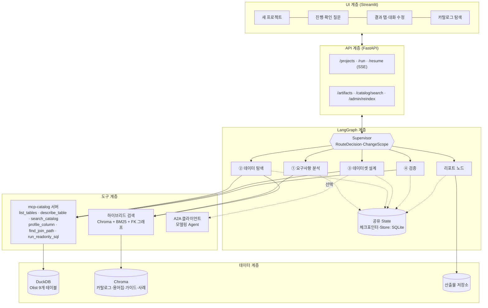
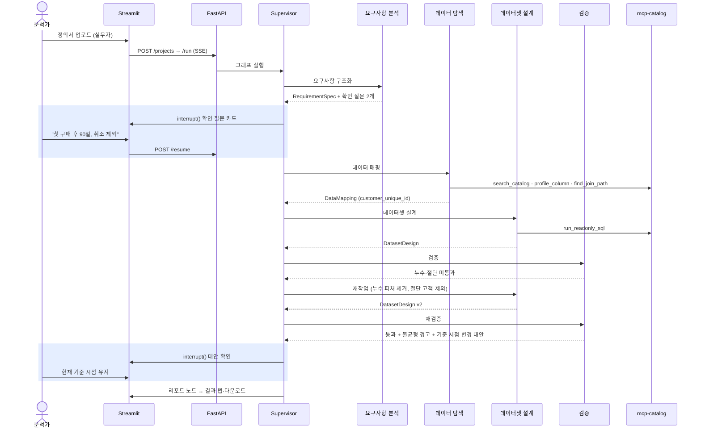

# Req2Data Agent – (서종해)

요구사항 정의서를 올리면 ML 데이터셋 설계(요구사항 구조화 → 데이터 매핑 → 타깃·피처 정의 → 마트 SQL → 검증)까지 자동으로 만들어 주는 LangGraph 기반 Multi-Agent 서비스입니다.

## 1. 프로젝트 개요

### 1.1 프로젝트 기획 배경

**해결하려는 문제** — 데이터 분석·ML 프로젝트에서 가장 오래 걸리고 실수가 잦은 구간은 모델링이 아니라 그 앞단, 즉 "고객 요구사항 정의서를 읽고 → 쓸 수 있는 데이터를 찾고 → ML 데이터셋을 정의·구현하는" 단계입니다. 모델 학습·배포는 코드와 MLOps 도구로 자동화가 많이 진행됐지만, 이 앞단은 여전히 담당자의 경험과 수작업에 의존합니다.

**기존 방식의 한계**

- **요구사항이 모호합니다.** 정의서에는 "재구매 가능성이 높은 고객을 찾고 싶다" 정도만 적혀 있고, 예측 대상 단위·예측 시점·타깃 기간·성공 기준이 빠져 있어 확인 미팅이 반복됩니다.
- **데이터를 찾는 데 시간이 많이 듭니다.** 테이블·컬럼 정의서가 여러 곳에 흩어져 있고, "어떤 테이블의 어떤 키로 조인해야 하는지"는 특정 담당자만 압니다.
- **설계 품질이 사람마다 다릅니다.** 분석 단위 키를 잘못 고르거나(예: 주문 단위 ID를 고객 ID로 오인), 예측 시점 이후에 생기는 정보를 피처에 넣는 데이터 누수(leakage)가 모델 성능이 비정상적으로 높게 나온 뒤에야 발견됩니다.
- **추적이 안 됩니다.** 어떤 요구사항이 어떤 컬럼·SQL로 구현됐는지 문서가 남지 않아, 요구사항이 바뀌면 처음부터 다시 확인해야 합니다.

**Agent로 해결할 수 있는 Pain Point** — 이 단계는 비정형 문서(정의서, 데이터 사전)를 읽고 해석해 정형 산출물(데이터셋 명세, SQL)로 바꾸는 일이라 LLM의 강점과 잘 맞습니다. 여기에 실제 DB 조회·SQL 실행 도구를 붙이면 "그럴듯한 답"이 아니라 실제 데이터로 검증된 설계를 만들 수 있습니다.

**동기** — 실제로 고객 요구사항 정의서 파악 → 데이터 확인 → 데이터셋 정의·구현 → 모델링 → 배포·운영 업무를 수행하면서, 앞단의 반복 작업과 누수 실수를 줄일 도구가 필요하다고 느꼈습니다. 이전 실습에서 만든 모델링·배포 자동화 Multi-Agent의 앞단을 채워 업무 전 과정을 연결하는 것이 목표입니다.

### 1.2 핵심 아이디어 및 가치 제안

**핵심 기능**

1. **요구사항 구조화와 확인 질문** — 정의서에서 비즈니스 목표, 예측 대상, 분석 단위, 예측 시점, 타깃 정의, 성공 지표(이상 필수 항목)와 제약(선택 항목)을 추출하고, 빠진 필수 항목은 사용자에게 질문합니다.
2. **데이터 매핑 (RAG)** — 데이터 카탈로그와 과거 설계 사례를 검색해 요구사항별 후보 테이블·컬럼·조인 경로를 근거와 함께 제시합니다.
3. **데이터셋 설계** — 분석 단위, 기준 시점, 관측·예측 윈도우, 타깃 정의, 피처 후보, 기준 시점 기반 train/val/test 분할(out-of-time)을 설계하고 데이터 마트 SQL을 생성합니다.
4. **자동 검증·탐색적 분석** — SQL을 실제로 실행해 행 수와 타깃 비율을 확인하고, 데이터 누수, 관측 기간 절단(right-censoring), 요구사항 반영률, 결측·품질을 점검해 기준 미달이면 스스로 재작업합니다. 타깃 분포, 피처별 타깃 비율, 피처 간 상관 등 EDA 요약과 함께 모델링 실익(타깃 비율·표본 수 기준)도 판정합니다.
5. **산출물 생성** — 데이터셋 명세서, 요구사항–데이터 추적표, 마트 SQL, 검증·EDA 리포트, 분할 컬럼이 포함된 데이터셋 파일(parquet)을 내려받을 수 있게 제공합니다.

**사용자 가치와 기대효과**

- 정의서 접수 후 첫 데이터셋 초안까지 걸리는 시간을 "며칠"에서 "한 번의 세션"으로 줄입니다.
- 확인 질문을 초기에 한꺼번에 정리해 고객과의 반복 미팅을 줄입니다.
- 누수·키 오류 같은 설계 실수를 모델링 전에 잡아 재작업을 줄입니다.
- 추적표가 남아 요구사항이 바뀌어도 영향받는 컬럼과 SQL을 바로 찾을 수 있습니다.

**기존 서비스와의 차별성**

| 구분 | 기존 Text-to-SQL·카탈로그 검색 | Req2Data Agent |
| --- | --- | --- |
| 입력 | 짧은 질문 ("지난달 매출은?") | 요구사항 정의서 전체 |
| 출력 | 쿼리 1개 또는 테이블 목록 | ML 데이터셋 설계 일체 (타깃·피처·SQL·검증) |
| 관점 | 조회 | 예측 시점, 분석 단위, 누수 등 ML 설계 관점 |
| 검증 | 쿼리 실행 여부 | 누수·반영률·품질 점검 후 자동 재작업 |
| 추적성 | 없음 | 요구사항 ↔ 컬럼 ↔ SQL 추적표 |

### 1.3 대상 사용자 및 기대 UX

**주요 타깃**

- **데이터 분석가·데이터 사이언티스트 (주 사용자)** — 정의서를 받아 데이터셋을 설계하는 실무자
- **PM·컨설턴트** — 요구사항을 정리하고 고객과 협의하는 기획자. 기술 상세보다 비즈니스 언어의 설명이 필요합니다.
- **신규 투입 분석가** — 도메인 데이터에 익숙하지 않아 카탈로그 탐색 도움이 필요한 사용자

**사용자 흐름**

1. 정의서를 올리거나(텍스트·파일) 샘플을 고르고, 사용자 유형(실무자/기획자)을 선택합니다.
2. Agent가 단계별로 일하는 모습을 실시간으로 봅니다.
3. 모호한 점에 대한 질문 카드에 답합니다.
4. 결과 탭에서 요구사항 명세, 데이터 매핑, 설계·SQL, 검증 리포트, 추적표를 확인합니다.
5. 대화로 수정을 요청하면("타깃 기간을 60일로 바꿔줘") 영향받는 단계만 다시 실행됩니다.
6. 산출물을 내려받습니다.

**구체적 Benefit** — 빈 화면에서 시작하지 않고 검증된 초안에서 시작합니다. 모든 매핑에 근거(카탈로그 출처)가 붙어 있어 결과를 믿고 쓸 수 있고, 누수 경고처럼 놓치기 쉬운 점을 먼저 짚어 줍니다.

## 2. 기술 구성

| 영역 | 적용 기술 |
| --- | --- |
| LLM | Ollama 로컬 LLM(Qwen2.5 7B Instruct) 기본. 환경변수로 OpenAI 호환 엔드포인트·Anthropic 또는 더 큰 로컬 모델(14B급)로 전환 |
| Agent | LangGraph (Supervisor + 4개 역할 Agent + 리포트 노드), LangChain Tool Calling, ReAct |
| RAG | Ollama 임베딩(bge-m3) + Chroma, BM25 하이브리드 검색 |
| 데이터 | Olist 브라질 이커머스 공개 데이터(테이블 9개) → DuckDB (LangGraph 체크포인터·Store는 SQLite) |
| 도구 연동 | MCP 서버(데이터 카탈로그·읽기 전용 SQL), A2A(모델링 Agent 연계) |
| 서비스 | Streamlit UI, FastAPI(SSE 스트리밍), Docker Compose |

API 키 발급이 어려운 환경을 고려해 모든 구성요소를 무료·로컬로 구성했고, LLM 제공자는 설정만 바꾸면 교체되도록 추상화했습니다.

### 2.1 Prompt Engineering 전략

**역할 기반 프롬프트** — Agent마다 실제 직무에 맞는 페르소나, 책임 범위, 금지 사항을 정의합니다.

| Agent | 역할 페르소나 | 핵심 지시 |
| --- | --- | --- |
| Supervisor | 데이터 프로젝트 PM | 다음 작업자 선택, 재작업 지시, 사용자 확인 필요 여부 판단 |
| 요구사항 분석 | 10년 차 비즈니스 분석가 | 정의서에 없는 내용을 추측해 채우지 말고 질문으로 남길 것 |
| 데이터 탐색 | 데이터 카탈로그 큐레이터 | 모든 매핑에 카탈로그 출처를 달고, 실제 스키마로 존재를 확인할 것 |
| 데이터셋 설계 | 시니어 데이터 사이언티스트 | 기준 시점 이후 정보를 피처에 쓰지 말 것, SQL은 반드시 실행해 확인할 것 |
| 검증 | 데이터 QA 리뷰어 | 체크리스트 항목별로 근거를 대고 통과/미통과를 판정할 것 |

**CoT·Few-shot 전략**

- **단계형 추론(Plan-and-Solve)** — 데이터셋 설계는 ① 분석 단위 → ② 기준 시점 → ③ 타깃 정의(관측 가능 기간 포함) → ④ 피처 후보 → ⑤ 누수 점검 → ⑥ 분할 설계 순서로 생각하도록 고정합니다. 추론 과정은 출력의 `rationale` 필드에 요약해 검증 Agent와 사용자가 확인할 수 있게 합니다.
- **동적 Few-shot** — "정의서 → 구조화 명세", "요구사항 → 데이터셋 설계" 예시를 도메인별로 여러 개 만들어 두고, 입력 정의서와 가장 비슷한 예시 2개를 검색해 프롬프트에 넣습니다.
- **자기 검토(Reflection)** — 검증 Agent의 피드백을 다음 시도의 프롬프트에 넣어 같은 실수를 반복하지 않게 합니다.

**출력 구조화 템플릿** — 모든 Agent 출력은 Pydantic 스키마로 받습니다.

| 스키마 | 생성 주체 | 주요 필드 |
| --- | --- | --- |
| `RequirementSpec` | 요구사항 분석 | 목표, 예측 대상, 분석 단위, 예측 시점, 타깃 정의, 성공 지표, 제약, 완성도 |
| `ClarificationQuestion` | 요구사항 분석·Supervisor | 질문, 대상 필드, 선택지, 질문 이유 |
| `DataMapping` | 데이터 탐색 | 요구사항 항목, 테이블·컬럼, 조인 경로, 근거 문서 |
| `DatasetDesign` | 데이터셋 설계 | 분석 단위 키, 기준 시점, 윈도우, 타깃, 피처(컬럼별 사용 가능 시점), 분할 규칙, SQL, `rationale` |
| `ReviewReport` | 검증 | 체크 항목별 판정·근거, EDA 요약, 모델링 실익 판정, 재작업 대상 |
| `RouteDecision` | Supervisor | 다음 Agent, 이유, 재작업 지시 |
| `ChangeScope` | Supervisor | 수정 요청이 바꾸는 State 필드, 재실행 시작 Agent |
| `TraceabilityRow` | 리포트 노드 | 요구사항 ID ↔ 컬럼 ↔ SQL 위치 ↔ 검증 결과 |

 스키마 검증에 실패하면 오류 내용을 넣어 한 번 더 요청하고, 그래도 실패하면 규칙 기반 기본값으로 대체합니다. 프롬프트는 코드와 분리해 YAML 파일로 버전 관리하고, temperature 0으로 일관성을 높입니다.

**사용자 유형·상황별 분기**

| 조건 | 분기 |
| --- | --- |
| 사용자 = 실무자 | SQL, 컬럼 상세, 누수 근거를 기술 용어로 설명 |
| 사용자 = 기획자 | 비즈니스 언어로 요약하고, 고객에게 확인할 질문을 우선 제시 |
| 정의서 완성도 낮음 | 설계를 멈추고 확인 질문 단계로 분기 |
| 필요한 데이터 없음 | 대체 데이터(프록시 변수) 제안 또는 추가 수집 필요 항목으로 정리 |
| 기준 시점·타깃 정의 변경이 필요 | 비즈니스 의사결정(예: 쿠폰 발송 시점)이 바뀌므로 자동 재작업하지 않고 대안을 제시해 사용자 확인 |
| 모델링 실익 낮음 (타깃 비율·표본 수 미달) | 불균형 경고와 함께 평가 지표(PR-AUC, 상위 N% Lift), 타깃 기간 확대 등 대안 제시 |
| 수정 요청(대화) | 변경 범위를 판단해 영향받는 Agent부터 재실행 |

### 2.2 LangChain / LangGraph 기반 Agent 구조

**Multi-Agent 설계 개념** — 계층형(Supervisor) 구조입니다. Supervisor가 상태를 보고 다음 작업을 맡길 Agent를 고르며, Agent끼리는 직접 호출하지 않고 공유 State로만 결과를 주고받습니다. 검증에서 문제가 나오면 원인 Agent로 되돌려 재작업을 시키고(최대 2회), 사용자 확인이 필요하면 `interrupt()`로 멈추고 답변을 받아 이어갑니다.

| Agent | 역할 | 구현 방식 | 주요 도구 |
| --- | --- | --- | --- |
| Supervisor | 라우팅, 재작업 지시, 사용자 확인 요청 | Structured Output 라우터 + 규칙 가드 | — |
| ① 요구사항 분석 | 정의서 구조화, 모호점 질문 생성 | Structured Output + 동적 Few-shot | 예시 검색 |
| ② 데이터 탐색 | 요구사항별 테이블·컬럼·조인 경로 매핑 | ReAct Agent | 카탈로그 검색(RAG), 스키마 조회, 컬럼 프로파일, 조인 경로 탐색 |
| ③ 데이터셋 설계 | 타깃·피처·윈도우·분할 설계, 마트 SQL 생성·실행 | ReAct Agent | 읽기 전용 SQL 실행, 타깃 비율 계산, 데이터셋 내보내기(parquet) |
| ④ 검증 | 누수·절단·반영률·품질 점검, EDA 요약, 재작업 대상 지정 | 규칙 기반 검사 + LLM 판단 | 시점 컬럼 검사, SQL 컬럼 계보 추출, 품질 프로파일 |
| 리포트 노드 (Agent 아님) | 명세서·추적표·SQL·리포트 생성 | 템플릿 + LLM 요약 (사용자 유형별) | 파일 저장 |

**Tool Calling·ReAct** — 데이터 탐색과 데이터셋 설계 Agent는 "생각 → 도구 호출 → 관찰"을 반복합니다. 예를 들어 카탈로그에서 `customer_id`를 찾은 뒤 실제 프로파일을 조회해 고유값이 주문 수와 같다는 것을 확인하고, 실제 고객 키인 `customer_unique_id`로 설계를 바꿉니다.

7B 로컬 모델은 긴 도구 호출 체인에서 형식 오류나 반복 호출이 잦기 때문에, 항상 필요한 앞부분 호출(카탈로그 검색 → 스키마 조회 → 프로파일 조회)은 코드로 고정해 결과를 State에 넣고, LLM은 그 결과를 보고 추가 조사·판단만 하도록 합니다. ReAct 호출 수는 `max_react_steps`로 제한합니다.

**누수·절단 검사 방식** — 카탈로그의 시점 컬럼 메타데이터(예: `order_purchase_timestamp`, `order_delivered_customer_date`, `review_creation_date`)를 기준으로, sqlglot으로 마트 SQL에서 각 피처가 참조하는 원천 컬럼을 추출해 "사용 가능 시점"을 계산합니다. 사용 가능 시점이 기준 시점보다 늦으면 누수로 판정합니다. 또한 데이터 마지막 날짜에서 기준 시점까지가 타깃 기간보다 짧은 행(타깃을 끝까지 관측할 수 없는 행)이 포함되면 절단 오류로 판정합니다.

**부분 재실행** — State 필드와 Agent의 의존 관계를 표로 정의합니다(예: `requirement_spec` → 탐색·설계·검증, `dataset_design.target_window` → 설계·검증). 수정 요청이 오면 Supervisor가 `ChangeScope`로 바뀌는 필드를 판정하고, `update_state`로 해당 필드를 고친 뒤 가장 앞선 영향 Agent부터 체크포인트에서 재개합니다. 영향받지 않는 결과(예: 데이터 매핑)는 그대로 재사용합니다.

**Memory**

- **단기 기억** — LangGraph 체크포인터(SQLite)에 프로젝트(스레드)별 상태를 저장해 대화로 수정하거나 중단 후 이어서 작업할 수 있습니다.
- **장기 기억** — 사용자가 승인한 설계는 "과거 설계 사례"로 저장해 다음 프로젝트의 RAG 검색 대상과 Few-shot 예시가 되고, 사용자 선호(사용자 유형, 기본 타깃 기간 등)는 LangGraph Store에 남깁니다.

### 2.3 RAG 구성

**지식 소스**

| 소스 | 내용 | 활용 Agent |
| --- | --- | --- |
| 데이터 카탈로그 | 테이블·컬럼 정의서(공개 데이터 사전 + 한글 설명), PK·FK, 자동 프로파일(결측률, 고유값 수, 값 범위, 예시 값) | ② 데이터 탐색 |
| 비즈니스 용어집·지표 정의서 | "재구매", "배송 지연" 등 용어와 계산 방법 | ① ② |
| 데이터셋 설계 가이드 | 누수 방지, 관측 기간 절단, 윈도우·분할 설계, 분석 단위 선택, 불균형 대응 체크리스트 | ③ ④ |
| 과거 설계 사례 | 승인된 설계(장기 기억에서 계속 추가) | ① ③ |

**전처리 파이프라인** — 원천 CSV를 DB에 적재한 뒤, 테이블별 프로파일을 자동으로 만들어 정의서 내용과 합칩니다. 카탈로그는 테이블 단위 문서 1개와 컬럼 단위 문서(컬럼별 1개)로 나눠 메타데이터(테이블, 컬럼, 타입, PK/FK, 시점 컬럼 여부)를 붙이고, 가이드·사례 문서는 Markdown 제목 단위로 청크합니다.

**임베딩·Vector DB** — 한글 요구사항과 영문 컬럼명을 함께 다뤄야 해서 다국어 임베딩 모델 bge-m3(Ollama)를 씁니다. Vector DB는 로컬 영속 저장과 메타데이터 필터를 지원하는 Chroma를 선택했습니다.

**검색 로직**

1. **쿼리 확장** — 요구사항 항목별로 검색 쿼리를 만들고, 용어집으로 동의어를 보강합니다(예: "재구매" → "두 번째 주문", "repeat purchase").
2. **하이브리드 검색** — 의미 검색(Chroma)과 키워드 검색(BM25)을 RRF로 합칩니다. 컬럼명처럼 정확히 일치해야 하는 검색은 키워드 검색이 강합니다.
3. **메타데이터 필터** — Agent가 필요한 소스 종류만 검색합니다(카탈로그 / 가이드 / 사례).
4. **FK 그래프 확장** — 검색된 테이블들을 잇는 조인 경로를 FK 그래프에서 찾아 함께 제공합니다.

**응답 생성** — 매핑마다 근거 문서(`table.column`)를 필수로 달게 하고, 검증 Agent가 실제 스키마와 대조해 존재하지 않는 테이블·컬럼(환각)을 걸러냅니다.

### 2.4 서비스 개발 및 패키징 계획

- **UI (Streamlit)** — ① 새 프로젝트(정의서 업로드·샘플 선택, 사용자 유형) ② 진행 화면(Agent별 단계 실시간 표시, 확인 질문 카드) ③ 결과 탭(요구사항 명세 / 데이터 매핑 / 설계·SQL / 검증 리포트 / 추적표, 다운로드) ④ 대화로 수정 ⑤ 데이터 카탈로그 탐색 페이지
- **백엔드 (FastAPI)**

| 엔드포인트 | 기능 |
| --- | --- |
| `POST /projects` | 프로젝트 생성(정의서, 사용자 유형) |
| `POST /projects/{id}/run` | 그래프 실행, Agent 진행 상황을 SSE로 스트리밍 |
| `POST /projects/{id}/resume` | 확인 질문 답변·수정 요청으로 재개, 이후 진행 상황을 SSE로 스트리밍 |
| `GET /projects/{id}/artifacts` | 산출물 조회·다운로드 |
| `GET /catalog/search` | 카탈로그 검색 |
| `POST /admin/reindex` | 데이터 적재·인덱스 재구축 |

- **배포** — Docker Compose로 `api`, `ui`, `mcp-catalog`, `ollama` 컨테이너를 한 번에 실행합니다. 단, macOS에서는 컨테이너 안의 Ollama가 Metal GPU를 쓰지 못해 매우 느리므로 Ollama는 호스트에서 실행하고 컨테이너는 `host.docker.internal`로 연결하는 구성을 기본으로 합니다(`ollama` 서비스는 Linux·GPU 환경용 profile로 분리). Docker 없이도 `make setup && make run`으로 로컬 실행이 가능하게 합니다.
- **설정·환경 관리** — `.env` + pydantic-settings로 LLM 제공자·모델·경로를 관리하고, 재작업 횟수·품질 기준 등 정책값은 `config.yaml`, 프롬프트는 `prompts/*.yaml`로 분리합니다. LLM이 없는 환경을 위해 기록된 응답으로 재현하는 데모 모드와 자동 테스트(pytest)를 포함합니다.

### 2.5 선택적 확장 기능

**A. Structured Output / Function Calling** — 모든 Agent 간 계약을 Pydantic 스키마로 정의하고, Supervisor의 라우팅도 `RouteDecision`(다음 Agent, 이유, 재작업 지시) 구조로 받습니다. LLM이 허용되지 않은 Agent를 고르면 규칙 가드가 막습니다.

**B. MCP 기반 도구 연동** — 데이터 카탈로그와 DB 접근을 별도 MCP 서버(`mcp-catalog`, FastMCP)로 분리합니다. 제공 도구는 `list_tables`, `describe_table`, `search_catalog`, `profile_column`, `find_join_path`, `run_readonly_sql`이며, Agent는 `langchain-mcp-adapters`로 연결합니다. 실제 사내 환경에서는 이 서버만 사내 DB·카탈로그에 맞게 교체하면 Agent 코드는 그대로 쓸 수 있습니다. SQL 실행은 다음과 같이 제한합니다.

- DuckDB를 `read_only=True`로 열고 `enable_external_access=false`로 설정해 SELECT 문 안에서도 `read_csv('/etc/...')` 같은 파일 시스템 접근을 막습니다.
- sqlglot으로 SQL을 파싱해 단일 SELECT(CTE 포함)만 허용하고, `ATTACH`·`COPY`·`INSTALL`·`LOAD`·`PRAGMA`와 파일 읽기 함수는 거부합니다. 참조 테이블은 카탈로그에 등록된 테이블로 한정합니다.
- 행 수(`max_rows`)·실행 시간(`timeout_seconds`) 제한을 겁니다.

**C. A2A 기반 Agent 협업 (2단계 구현)** — 설계가 끝난 데이터셋(분할 컬럼이 포함된 parquet + `DatasetDesign`)을 이전 실습에서 만든 모델링 Agent(A2A 서버로 래핑)에 보내 베이스라인 모델을 학습시키고, 성능과 피처 중요도를 돌려받습니다. 서로 다른 프로세스의 Agent가 Agent Card로 능력을 확인하고 표준 메시지로 협업하는 구조입니다.

### 2.6 개발 범위와 우선순위

| 우선순위 | 범위 | 완료 기준 |
| --- | --- | --- |
| P0 (필수) | LangGraph Supervisor + 4개 Agent + 리포트 노드, Pydantic 스키마, mcp-catalog(읽기 전용 SQL 포함), 누수·절단 검사, Streamlit 기본 화면, 재구매 시나리오 | 재구매 시나리오가 확인 질문 → 매핑 → 설계 → 검증·재작업 → 산출물까지 끝까지 실행됨 |
| P1 (권장) | 하이브리드 RAG(BM25 + FK 그래프), 동적 Few-shot, 대화형 수정(부분 재실행), 사용자 유형별 분기, 샘플 정의서 2종 추가, 품질 평가 | 샘플 3종 평가 결과표 작성, "타깃 기간 60일" 수정 시 매핑 재사용 확인 |
| P2 (선택) | A2A 모델링 Agent 연계, 장기 기억(승인 설계 사례화·사용자 선호), Docker Compose 패키징 | 베이스라인 성능·피처 중요도가 UI에 표시됨 |

### 2.7 주요 리스크와 대응

| 리스크 | 대응 |
| --- | --- |
| 7B 로컬 모델의 도구 호출·구조화 출력 불안정 | 앞부분 도구 호출을 코드로 고정, 스키마 재요청 1회 후 규칙 기반 기본값, 상위 모델 전환 옵션, 데모 모드 |
| SQL 실행을 통한 파일 시스템 접근 | DuckDB `enable_external_access=false`, sqlglot 기반 허용 목록 검사 |
| 극단적 클래스 불균형으로 베이스라인 성능 저조 | 모델링 실익 판정과 대안(지표·타깃 기간) 제시를 기능으로 포함 |
| macOS에서 Docker Ollama 성능 저하 | 호스트 Ollama를 기본 구성으로 사용 |
| 장기 기억으로 평가 데이터 오염 | 평가용 샘플 정의서·정답 설계는 사례 저장소와 Few-shot 후보에서 제외 |

## 3. 주요 기능 및 동작 시나리오

### 3.1 사용자 시나리오

**사용자 목표** — 데이터 분석가 A씨는 이커머스 마케팅팀에서 "첫 구매 고객 중 재구매 가능성이 낮은 고객에게 쿠폰을 보내고 싶다"는 요구사항 정의서를 받았습니다. 목표는 이 요구사항을 모델 학습에 바로 쓸 수 있는 데이터셋으로 만드는 것입니다.

| 단계 | 사용자 행동 | 서비스 동작 |
| --- | --- | --- |
| 1. 프로젝트 생성 | 정의서를 업로드하고 사용자 유형을 "실무자"로 선택 | 프로젝트(스레드) 생성, Supervisor가 요구사항 분석 Agent에 위임 |
| 2. 요구사항 구조화 | 진행 화면에서 추출 결과 확인 | 목표, 예측 대상(첫 구매 고객), 성공 지표를 구조화하고, 빠진 항목 2개를 질문으로 정리: "재구매 판단 기간은?", "취소 주문도 포함하나요?" |
| 3. 확인 질문 응답 | "첫 구매 후 90일, 취소 제외"라고 답변 | `interrupt()`로 멈췄던 그래프가 답변을 반영해 재개 |
| 4. 데이터 매핑 | 매핑 탭에서 후보 테이블·컬럼과 근거 확인 | 카탈로그를 검색해 주문·고객·결제·리뷰·상품 테이블을 매핑. 프로파일 조회로 `customer_id`가 주문마다 새로 발급되는 키라는 것을 발견하고, 고객 단위 키를 `customer_unique_id`로 지정 |
| 5. 데이터셋 설계 | 설계·SQL 탭 확인 | 분석 단위(고객), 기준 시점(첫 구매 시각), 타깃(90일 내 두 번째 주문), 피처(첫 주문 금액, 결제 수단, 할부, 카테고리, 지역, 리뷰 점수, 실제 배송 소요일 등)를 설계하고, 기준 시점 기준으로 train/val/test를 나눈 뒤 SQL을 실행해 행 수와 타깃 비율 확인 |
| 6. 자동 검증·재작업 | 검증 리포트 확인 | ① 리뷰 점수·실제 배송 소요일은 기준 시점 이후에 생기는 정보라 누수로 판정, ② 데이터 마지막 날짜 전 90일 안에 첫 구매한 고객은 타깃을 끝까지 관측할 수 없어 절단 오류로 판정 → Supervisor가 설계 Agent에 재작업 지시 → 누수 피처 제거, 해당 고객 제외 후 재검증 통과. 기준 시점을 배송 완료 시각으로 옮기면 배송 관련 피처를 쓸 수 있지만 쿠폰 발송 시점이 바뀌는 결정이라, 대안으로만 제시하고 사용자 확인(`interrupt()`)을 받음. 리뷰는 배송 후에 작성되는 경우가 많아 이 대안에서도 누수로 남는다는 점을 함께 안내 |
| 6-1. 모델링 실익 판정 | EDA 요약 확인 | Olist 고객 대부분은 주문이 한 번뿐이라 90일 재구매 비율이 매우 낮음(`min_target_ratio` 미달) → 클래스 불균형 경고, PR-AUC·상위 N% Lift 지표와 타깃 기간 확대안 제시 |
| 7. 대화로 수정 | "타깃 기간을 60일로 바꿔줘" 입력 | `ChangeScope`로 변경 필드(타깃 기간)를 판정해 설계·검증 Agent만 재실행 (매핑은 그대로 재사용, 절단 기준도 60일로 다시 계산) |
| 8. 산출물 다운로드 | 명세서·추적표·SQL·검증 리포트·데이터셋(parquet) 다운로드, 설계 승인 | 승인된 설계를 과거 사례로 저장(장기 기억) |
| 9. (선택) 베이스라인 확인 | "베이스라인 모델 돌려줘" | A2A로 모델링 Agent에 데이터셋을 보내 성능·피처 중요도를 받아 표시 |

같은 데이터로 두 가지 샘플 정의서(배송 지연 예측, 불만 리뷰 예측)도 제공해, 요구사항이 달라지면 분석 단위(주문)와 기준 시점(결제 승인 시각)도 달라지는 것을 보여 줍니다.

### 3.2 시스템 구조도 / Multi-Agent 구성도

Supervisor만 다른 Agent를 호출하고, 모든 Agent는 Tool Calling으로만 데이터에 접근합니다. DB·카탈로그 접근은 MCP 서버 뒤에 있어, 사내 시스템으로 바꿀 때 MCP 서버만 교체하면 됩니다.

### 3.3 서비스 플로우

파란 영역은 그래프가 `interrupt()`로 멈춰 사용자 답변을 기다리는 구간이고, 점선 화살표는 Agent가 Supervisor에 결과를 보고하는 흐름입니다. 각 단계의 진행 상황은 FastAPI가 SSE로 UI에 실시간 전달합니다.

1. **사용자 요청** — UI에서 정의서를 올리면 FastAPI가 프로젝트 스레드로 그래프를 실행합니다.
2. **Agent 처리** — Supervisor가 State를 보고 다음 Agent를 고릅니다(`RouteDecision`).
3. **RAG 검색** — 데이터 탐색 Agent가 카탈로그·용어집을 하이브리드 검색하고, MCP 서버로 실제 스키마와 프로파일을 확인합니다.
4. **응답 생성** — 설계 Agent가 SQL을 실행해 검증한 설계를 만들고, 검증을 통과하면 리포트로 정리합니다.
5. **UI 출력** — 결과 탭에 명세서·매핑·SQL·검증 리포트·추적표를 표시하고, 대화 수정 요청은 같은 스레드에서 이어서 처리합니다.

## 4. 실행 결과

구현이 끝나면 아래 항목을 채웁니다.

- **개발 환경 실행 결과** — 데이터 적재·인덱싱 로그, `pytest` 결과, API 기동 로그
- **서비스 실행 결과(text)** — 재구매 예측 시나리오의 Agent 단계별 로그, 생성된 데이터셋 명세서·SQL·검증 리포트 발췌
- **데모 이미지** — Streamlit 화면(프로젝트 생성, 진행·확인 질문, 결과 탭, 대화 수정) 캡처
- **품질 평가** — 샘플 정의서 3종에 대해 아래 지표를 측정합니다. 평가용 정의서와 정답 설계는 장기 기억·Few-shot 후보에서 제외해 오염을 막습니다.
  - 정답 매핑 대비 테이블·컬럼 재현율, 존재하지 않는 테이블·컬럼(환각) 비율
  - 의도적으로 넣은 누수 피처·절단 오류의 탐지율
  - 마트 SQL 실행 성공률, 재작업 횟수(최대 2회 내 수렴 여부)
  - 확인 질문 적절성(정답 모호 항목 대비 질문 재현율)

## 5. 추가 아이디어

- **사내 환경 연동** — MCP 서버만 교체해 사내 데이터 카탈로그·DW(Hive, BigQuery 등)에 연결하고, 권한에 따라 조회 범위를 제한
- **다양한 입력 문서** — PDF·Word·PPT 형식의 요구사항 정의서, 회의록을 파싱해 입력으로 사용
- **설계 품질 평가 고도화** — 정답 설계 데이터셋을 늘려 프롬프트·모델 변경 시 회귀 테스트로 품질을 자동 비교
- **전 과정 연결** — A2A로 모델링·배포·운영 Agent까지 연결해 요구사항부터 운영까지 하나의 흐름으로 자동화
- **협업 기능** — 기획자가 확인 질문을 고객에게 바로 전달하고 답변을 받아 설계에 반영하는 공유 링크, 변경 이력 비교
- **피처 추천 고도화** — 과거 프로젝트의 피처 중요도를 누적해 새 요구사항에 효과가 검증된 피처를 우선 추천
