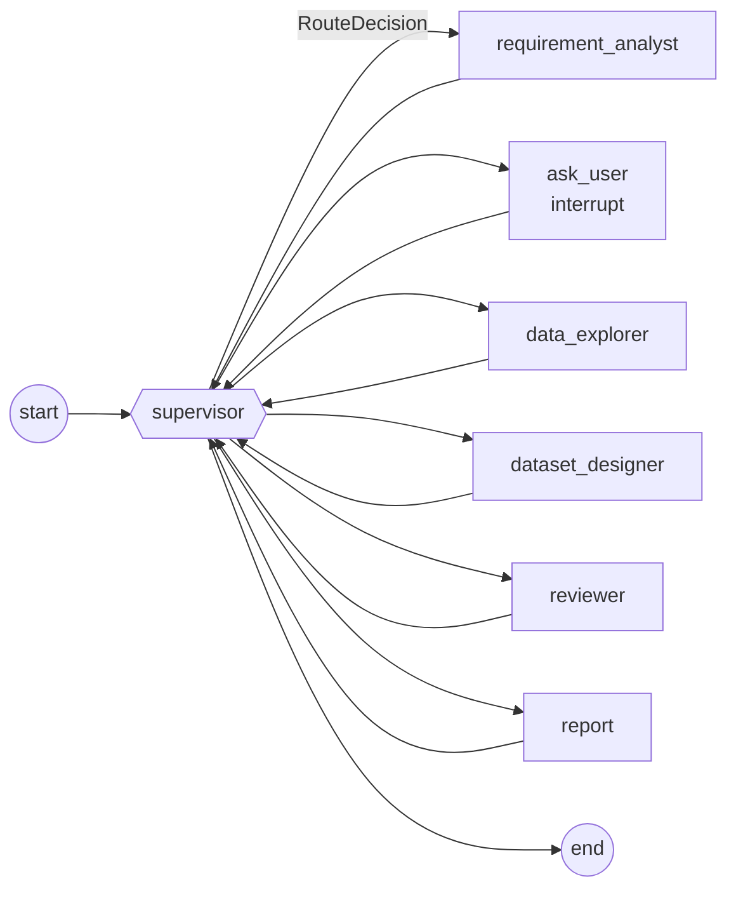

# Agent 구조 설계

PRD 2.1(Prompt Engineering 전략)·2.2(Agent 구조)를 코드 구조로 옮긴 설계입니다.

## 1. 전체 그래프



- Agent끼리는 직접 호출하지 않고, 모든 노드가 끝나면 `supervisor`로 돌아옵니다.
- State에는 Pydantic 모델을 `model_dump(mode="json")`한 dict만 넣습니다(체크포인터 직렬화·SSE 전송이 단순해짐). 읽을 때 `graph.state.load()`로 다시 검증합니다.
- `ask_user`는 `interrupt()`로 멈추고 `Command(resume={"answers": {질문 ID: 답변}})`으로 재개합니다. 답을 `answers`로 감싸는 이유는 LangGraph가 resume dict의 키를 interrupt ID로 해석할 수 있기 때문입니다. 빠진 답은 `default_option`으로 채웁니다.
- 대화형 수정은 같은 스레드에 `{"change_request": "..."}`를 입력으로 새로 실행합니다.

## 2. Supervisor = 규칙 가드 + Structured Output 라우터

1. 규칙(`agents/supervisor.py:candidates`)이 State를 보고 **허용 후보**와 **기본 선택**을 계산합니다.
2. 후보가 하나면 LLM을 부르지 않습니다(결정적·저비용).
3. 후보가 여럿일 때만 LLM이 `RouteDecision`을 고르고, 후보 밖을 고르면 가드가 기본 선택으로 되돌립니다.
4. 대화형 수정 요청은 LLM이 `ChangeScope`(바뀐 필드, 재시작 Agent)를 판정하고, 재시작 지점 이후 산출물만 지운 뒤 재개합니다. 판정 실패 시 키워드 규칙으로 대체합니다.

| 상황 | 다음 노드 |
| --- | --- |
| 수정 요청 있음 | `ChangeScope.restart_from` |
| 답하지 않은 질문 있음 | `ask_user` |
| 요구사항 명세 없음 / 새 답변 미반영 | `requirement_analyst` |
| 매핑 없음 | `data_explorer` |
| 설계 없음 | `dataset_designer` |
| 현재 설계 버전이 검증되지 않음 | `reviewer` |
| 검증 미통과 & 재작업 한도 이내 | `ReviewReport.rework_target` (여럿이면 LLM 선택) |
| 검증 통과 & 미뤄 둔 확인 질문 | `ask_user` |
| 산출물 없음 | `report` |
| 그 외 | `end` |

## 3. Agent별 구성

| Agent | 프롬프트 | 실행 방식 | 출력 |
| --- | --- | --- | --- |
| requirement_analyst | `prompts/requirement_analyst.yaml` + 동적 Few-shot | Structured Output | `RequirementSpec`, `ClarificationQuestion[]` |
| data_explorer | `prompts/data_explorer.yaml` | 고정 선행 조회 → (선택) ReAct → Structured Output → 스키마 대조로 환각 제거 | `DataMapping` |
| dataset_designer | `prompts/dataset_designer.yaml` + 동적 Few-shot | Plan-and-Solve → (선택) ReAct → Structured Output → SQL 실행 확인·1회 수정 | `DatasetDesign` |
| reviewer | `prompts/reviewer.yaml` | 규칙 검사(판정) + LLM 요약(설명만) | `ReviewReport` |
| report (노드) | `prompts/report.yaml` | 템플릿 + 사용자 유형별 LLM 요약 | 산출물 파일, `TraceabilityRow[]` |

### 프롬프트 공통 구조 (`agents/prompts.py`)

```
[페르소나]  → [책임] → [금지 사항] → [사고 절차(Plan-and-Solve)]
→ [사용자 유형별 지침] → [이전 검증 피드백(Reflection)] → [출력 형식(JSON 스키마)]
```

- YAML에 `version`을 두어 프롬프트 변경 이력을 관리합니다.
- 모든 LLM 호출은 temperature 0(`.env`의 `LLM_TEMPERATURE`)입니다.

### Structured Output 처리 (`llm/structured.py`)

```
LLM 호출 → JSON 추출 → Pydantic 검증
  ├ 성공 → 반환
  └ 실패 → 오류 내용을 넣어 재요청 (config.yaml workflow.structured_output_retries 회)
            └ 그래도 실패 → Agent별 규칙 기반 기본값 (used_fallback=True, trace에 기록)
```

### 동적 Few-shot (`agents/fewshot.py`)

- `prompts/fewshot/*.yaml`의 예시 중 입력과 가장 비슷한 `rag.fewshot_k`개를 BM25(문자 bigram, 한글 대응)로 고릅니다.
- 평가용 샘플 정의서와 같은 도메인의 예시는 넣지 않습니다(PRD 2.7 평가 오염 방지). RAG 인덱스가 생기면 같은 인터페이스로 벡터 검색으로 교체합니다.

### Reflection

- `reviewer`가 남긴 피드백은 `state.feedback[agent]`에 쌓이고, 다음 시도의 시스템 프롬프트 "이전 검증 피드백"에 들어갑니다.

### 검증 규칙 (`agents/reviewer.py`)

| 검사 | 근거 | 재작업 대상 |
| --- | --- | --- |
| `sql_execution` | 마트 SQL 실행 성공 여부 | dataset_designer |
| `schema_existence` | 매핑·피처가 참조한 `table.column`이 실제 스키마에 있는지 | data_explorer / dataset_designer |
| `leakage` | sqlglot lineage로 피처의 원천 컬럼을 추출, 카탈로그 `available_at`의 `time_rank`가 기준 시점보다 늦으면 누수 | dataset_designer |
| `censoring` | 데이터 마지막 시각 − 타깃 기간 이후의 기준 시점 행이 남아 있으면 절단 오류 | dataset_designer |
| `coverage` | 요구사항 항목 중 매핑·설계에 반영된 비율 ≥ `review.min_requirement_coverage` | data_explorer / dataset_designer |
| `quality` | 피처 결측률 ≤ `review.max_null_ratio` | 경고 |
| `target_ratio` / `row_count` | `review.min_target_ratio`, `review.min_rows` | 경고 + 모델링 실익 판정 |
| `split` | 분할 컬럼에 train/val/test가 모두 있는지 | dataset_designer |

누수가 발견되면 "기준 시점을 더 늦은 시각으로 옮기는 안"을 확인 질문으로 만들어 두고, 검증 통과 후 사용자에게 묻습니다(기준 시점은 비즈니스 결정이므로 자동으로 바꾸지 않음).

## 4. 도구 경계 (`tools/catalog.py`)

Agent는 `CatalogClient` 프로토콜에만 의존합니다. 지금은 테스트용 DuckDB 구현(`tests/fixtures/fake_catalog.py`)으로 검증하고, 이후 `mcp-catalog` 서버 클라이언트를 같은 프로토콜로 붙입니다.

| 메서드 | 용도 |
| --- | --- |
| `list_tables`, `describe_table` | 스키마·컬럼 메타데이터(PK/FK, 시점 컬럼, `time_rank`, `available_at`) |
| `search_catalog` | 카탈로그 검색(RAG) |
| `profile_column` | 결측률, 고유값 수 등 |
| `find_join_path` | FK 그래프 조인 경로 |
| `run_readonly_sql` | 읽기 전용 SQL |

## 5. 아직 구현하지 않은 부분

- `mcp-catalog` 서버와 MCP 기반 `CatalogClient`, RAG 인덱스(벡터 Few-shot 포함)
- 데이터셋 parquet 내보내기(MCP 서버 도구로 추가 예정)
- 데모 모드(기록 응답 재생), FastAPI·Streamlit, 장기 기억
