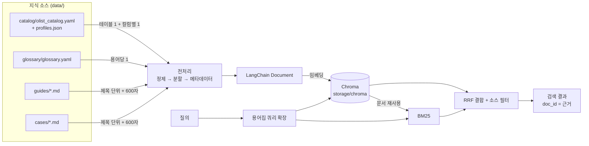

# RAG 구성

PRD 2.3을 구현한 구조입니다.

## 1. 흐름



| 구성 | 파일 |
| --- | --- |
| 카탈로그·용어집 로더 | `rag/sources.py` |
| CSV 적재·자동 프로파일 | `rag/profiling.py`, `scripts/load_olist.py` |
| 전처리 (정제·분할·메타데이터·중복 제거) | `rag/preprocess.py` |
| 소스별 문서 조립 | `rag/documents.py` `build_documents` |
| 임베딩 (기본 Azure text-embedding-3-small, 교체 가능) | `rag/embeddings.py` |
| Chroma 인덱스 (`langchain_chroma.Chroma`) | `rag/index.py`, `scripts/build_index.py` |
| 하이브리드 검색기 (`BaseRetriever`) | `rag/retriever.py`, `rag/tokenize.py` |
| 검색·RAG 체인 (LCEL) | `llm/chains.py` |
| 인용 근거 검증 | `agents/citations.py` |
| FK 그래프 조인 경로 | `rag/fk_graph.py` |
| 진입점·사례 추가 | `rag/knowledge_base.py` |
| Agent 연결 (DuckDB + RAG) | `tools/local_catalog.py`, `tools/sql_guard.py` |

## 2. 지식 소스

| 소스 | 내용 | 사용하는 Agent |
| --- | --- | --- |
| `catalog` | 9개 테이블 정의(한글·영문 설명, PK/FK, 행 단위), 시점 컬럼 순서 `time_rank`, 값 확정 시점 `available_at`, 자동 프로파일 | 데이터 탐색 |
| `glossary` | 용어 13개: 정의, 계산법, 동의어, 관련 컬럼 | 요구사항 분석, 데이터 탐색 |
| `guide` | 설계 가이드 머리말과 9개 절: 분석 단위, 기준 시점, 누수, 절단, 윈도우, 분할, 불균형, 결측, Olist 주의사항 | 데이터셋 설계, 검증 |
| `case` | 승인된 설계(`KnowledgeBase.add_case`로 추가, 즉시 검색 가능) | 요구사항 분석, 데이터셋 설계 |

`time_rank`와 `available_at`은 검증 Agent의 누수 판정 근거이기도 합니다.

## 3. 전처리

`rag/preprocess.py`의 단계를 모든 소스가 거칩니다.

1. **정제** (`clean_text`): 유니코드 NFC 정규화, 제어 문자·줄 끝 공백 제거, 빈 줄 3개 이상 축약.
2. **분할** (`split_markdown`): Markdown은 `MarkdownHeaderTextSplitter`로 제목(`#`, `##`, `###`) 단위로 나누고, 긴 구간은 `RecursiveCharacterTextSplitter`로 다시 나눕니다 (`config.yaml`의 `rag.chunk_size` 600자, `rag.chunk_overlap` 80자). 카탈로그와 용어집은 이미 의미 단위(테이블·컬럼·용어)라 더 나누지 않습니다.
3. **메타데이터 부여** (`enrich_metadata`): 모든 문서에 `source`, `kind`, `title`, `path`, `chunk_index`, `table`, `column`, `content_hash`를 붙입니다. 컬럼 문서에는 `type`, `is_pk`, `fk`, `is_time`, `time_rank`, `available_at`도 들어갑니다.
4. **중복 제거** (`dedupe`): 빈 문서와 내용이 같은 문서를 버립니다.

인덱스에는 만든 임베딩 이름과 문서 지문(`corpus_fingerprint`)을 함께 저장합니다. 서비스 시작 시 `KnowledgeBase.ensure_current()`가 둘 중 하나라도 지금 설정과 다르면 인덱스를 다시 만듭니다. 임베딩 서버에 닿지 못하면 기존 인덱스를 두고 키워드 검색으로 계속합니다.

## 4. 검색 로직

`HybridRetriever`는 LangChain `BaseRetriever`라서 `retriever.invoke(query)`로 부르거나 LCEL 체인(`retriever | ...`)에 넣을 수 있습니다. 결과 `Document`의 메타데이터에 `score`와 검색기별 순위 `ranks`가 들어갑니다.


1. **쿼리 확장**: 용어집 표면형(용어·동의어)이 질의에 있으면 동의어와 관련 컬럼을 덧붙입니다. 공백 차이는 무시하고, 한 글자 표면형은 오탐 때문에 쓰지 않습니다.
2. **하이브리드 검색**: Chroma 코사인 검색과 BM25를 각각 상위 30개씩 뽑아 RRF(`config.yaml rag.rrf_k`, `hybrid_weights`)로 합칩니다. BM25 토크나이저는 한글 문자 bigram과 영문 단어·밑줄 조각(`customer_unique_id` → `customer`, `unique`, `id`)을 함께 씁니다.
3. **메타데이터 필터**: `source`(catalog / glossary / guide / case)로 필요한 소스만 검색합니다.
4. **FK 그래프 확장**: 검색된 테이블을 Steiner tree로 최소 조인 경로로 잇습니다. PK가 아닌 컬럼을 가리키는 FK(우편번호 등 N:M)는 가중치를 높여 다른 경로가 있으면 피합니다.

## 5. Agent 연결과 근거 반영

모든 검색은 `CatalogClient.search_catalog(query, k, source)` 하나로 이루어지고, Agent는 이를 감싼 `CatalogRetriever`와 `retrieval_chain`(검색 → 문서 + 프롬프트용 문맥)을 씁니다. 문맥에는 문서마다 `[doc_id]`가 붙습니다.

- 각 Agent의 출력 스키마에는 `citations`(`doc_id`, `used_for`)가 있어, LLM이 판단에 쓴 문서를 적습니다.
- `validate_citations`가 실제로 검색해 프롬프트에 넣은 문서만 남기고, 나머지는 버린 뒤 `trace`에 기록합니다.
- 남은 인용은 State의 `citations`에 쌓이고, 최종 `summary.md`의 "참고 근거" 절에 표로 출력됩니다.
- 검증 Agent의 `check_grounding`이 매핑과 설계에 인용 근거가 있는지 확인합니다.
- 탐색·설계 Agent는 도구 호출 루프에서 `search_catalog`·`search_knowledge` 도구로 직접 검색할 수도 있고, 이때 찾은 문서도 인용 대상이 됩니다.

| Agent | 넣는 내용 |
| --- | --- |
| 요구사항 분석 | 정의서로 검색한 용어집·과거 사례를 시스템 프롬프트에 넣음 |
| 데이터 탐색 | 카탈로그 검색 결과 + 용어집 정의를 선행 조회 결과에 넣음. 매핑은 실제 스키마와 대조해 환각 컬럼 제거 |
| 데이터셋 설계 | 설계 가이드·과거 사례를 시스템 프롬프트에 넣음 |
| 검증 | 경고·미통과 항목으로 가이드를 검색해 설명 근거로 사용 |

## 6. 실행

```bash
make rag-flow   # 전처리 → 인덱싱 → 검색 → 근거 포함 응답을 단계별로 출력
make index   # CSV 없이 카탈로그 정의·용어집·가이드만 색인
make data    # Olist CSV 적재 → 프로파일 → 색인 (CSV를 data/raw/olist/에 둔 뒤)
uv run python scripts/build_index.py --query "재구매 고객 키" --source catalog
uv run pytest -m llm tests/integration/test_rag_live.py   # 실제 bge-m3 검색 품질 확인
```

## 7. SQL 안전장치

`LocalCatalogClient.run_readonly_sql`은 두 겹으로 막습니다.

- `tools/sql_guard.py`: sqlglot으로 단일 SELECT(CTE·UNION 포함)만 허용하고, 파일 읽기 함수와 카탈로그에 없는 테이블을 거부합니다.
- DuckDB를 `read_only=True`, `enable_external_access=false`로 엽니다.
- 행 수(`sql.max_rows`)와 실행 시간(`sql.timeout_seconds`, 초과 시 interrupt)도 제한합니다.
