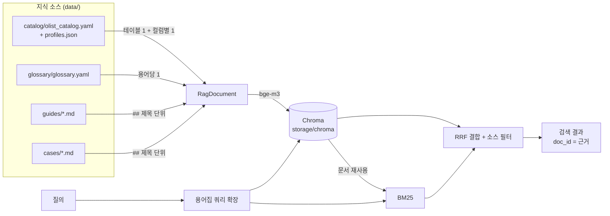

# RAG 구성

PRD 2.3을 구현한 구조입니다.

## 1. 흐름



| 구성 | 파일 |
| --- | --- |
| 카탈로그·용어집 로더 | `rag/sources.py` |
| CSV 적재·자동 프로파일 | `rag/profiling.py`, `scripts/load_olist.py` |
| 문서화·청크 | `rag/documents.py` |
| 임베딩 (bge-m3, 교체 가능) | `rag/embeddings.py` |
| Chroma 인덱스 | `rag/index.py`, `scripts/build_index.py` |
| 하이브리드 검색 | `rag/retriever.py`, `rag/tokenize.py` |
| FK 그래프 조인 경로 | `rag/fk_graph.py` |
| 진입점·사례 추가 | `rag/knowledge_base.py` |
| Agent 연결 (DuckDB + RAG) | `tools/local_catalog.py`, `tools/sql_guard.py` |

## 2. 지식 소스

| 소스 | 내용 | 사용하는 Agent |
| --- | --- | --- |
| `catalog` | 9개 테이블 정의(한글·영문 설명, PK/FK, 행 단위), 시점 컬럼 순서 `time_rank`, 값 확정 시점 `available_at`, 자동 프로파일 | 데이터 탐색 |
| `glossary` | 용어 13개: 정의, 계산법, 동의어, 관련 컬럼 | 요구사항 분석, 데이터 탐색 |
| `guide` | 설계 가이드 9개 절: 분석 단위, 기준 시점, 누수, 절단, 윈도우, 분할, 불균형, 결측, Olist 주의사항 | 데이터셋 설계, 검증 |
| `case` | 승인된 설계(`KnowledgeBase.add_case`로 추가, 즉시 검색 가능) | 요구사항 분석, 데이터셋 설계 |

`time_rank`와 `available_at`은 검증 Agent의 누수 판정 근거이기도 합니다.

## 3. 검색 로직

1. **쿼리 확장**: 용어집 표면형(용어·동의어)이 질의에 있으면 동의어와 관련 컬럼을 덧붙입니다. 공백 차이는 무시하고, 한 글자 표면형은 오탐 때문에 쓰지 않습니다.
2. **하이브리드 검색**: Chroma 코사인 검색과 BM25를 각각 상위 30개씩 뽑아 RRF(`config.yaml rag.rrf_k`, `hybrid_weights`)로 합칩니다. BM25 토크나이저는 한글 문자 bigram과 영문 단어·밑줄 조각(`customer_unique_id` → `customer`, `unique`, `id`)을 함께 씁니다.
3. **메타데이터 필터**: `source`(catalog / glossary / guide / case)로 필요한 소스만 검색합니다.
4. **FK 그래프 확장**: 검색된 테이블을 Steiner tree로 최소 조인 경로로 잇습니다. PK가 아닌 컬럼을 가리키는 FK(우편번호 등 N:M)는 가중치를 높여 다른 경로가 있으면 피합니다.

## 4. Agent 연결

모든 검색은 `CatalogClient.search_catalog(query, k, source)` 하나로 이루어집니다. 결과의 `doc_id`(예: `column:customers.customer_unique_id`)가 근거 표기입니다.

| Agent | 넣는 내용 |
| --- | --- |
| 요구사항 분석 | 정의서로 검색한 용어집·과거 사례를 시스템 프롬프트에 넣음 |
| 데이터 탐색 | 카탈로그 검색 결과 + 용어집 정의를 선행 조회 결과에 넣음. 매핑은 실제 스키마와 대조해 환각 컬럼 제거 |
| 데이터셋 설계 | 설계 가이드·과거 사례를 시스템 프롬프트에 넣음 |
| 검증 | 경고·미통과 항목으로 가이드를 검색해 설명 근거로 사용 |

## 5. 실행

```bash
make index   # CSV 없이 카탈로그 정의·용어집·가이드만 색인
make data    # Olist CSV 적재 → 프로파일 → 색인 (CSV를 data/raw/olist/에 둔 뒤)
uv run python scripts/build_index.py --query "재구매 고객 키" --source catalog
uv run pytest -m llm tests/integration/test_rag_live.py   # 실제 bge-m3 검색 품질 확인
```

## 6. SQL 안전장치

`LocalCatalogClient.run_readonly_sql`은 두 겹으로 막습니다.

- `tools/sql_guard.py`: sqlglot으로 단일 SELECT(CTE·UNION 포함)만 허용하고, 파일 읽기 함수와 카탈로그에 없는 테이블을 거부합니다.
- DuckDB를 `read_only=True`, `enable_external_access=false`로 엽니다.
- 행 수(`sql.max_rows`)와 실행 시간(`sql.timeout_seconds`, 초과 시 interrupt)도 제한합니다.
