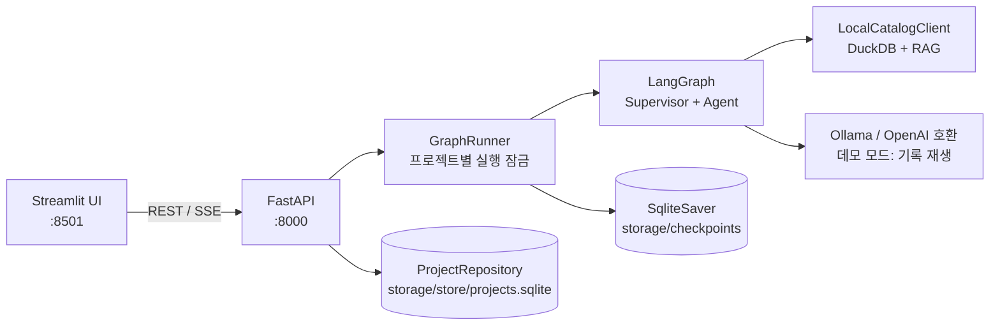

# 서비스 개발 및 패키징

PRD 2.4를 구현한 구조입니다.

## 1. 구성



| 구성 | 파일 |
| --- | --- |
| API 앱·라우터 | `src/req2data/api/main.py`, `api/routers/{projects,catalog,admin}.py` |
| 서비스 조립 | `src/req2data/service/services.py` |
| 그래프 실행·SSE 이벤트 | `src/req2data/service/runner.py` |
| 프로젝트 메타데이터 | `src/req2data/service/projects.py` |
| 데모 모드 (기록·재생) | `src/req2data/llm/recording.py` |
| UI | `ui/app.py`, `ui/pages/{new_project,project,catalog}.py`, `ui/api_client.py` |
| 패키징 | `docker/Dockerfile`, `docker-compose.yml`, `Makefile` |

프로젝트 ID가 곧 LangGraph 스레드 ID입니다. 그래프 상태(명세·매핑·설계·검증·질문)는 체크포인터에, 제목·상태·승인 여부는 프로젝트 저장소에 둡니다.

## 2. API

| 엔드포인트 | 기능 |
| --- | --- |
| `POST /projects` | 프로젝트 생성 (`document`, `user_type`: practitioner / planner, `title`) |
| `GET /projects`, `GET /projects/{id}` | 목록, 상세 (프로젝트 + 그래프 상태 + 대기 중인 질문) |
| `POST /projects/{id}/run` | 그래프 시작, SSE 스트리밍 |
| `POST /projects/{id}/resume` | `answers`(확인 질문 답변) 또는 `change_request`(대화형 수정)로 재개, SSE 스트리밍. 중단된 실행은 본문 없이 호출하면 이어서 실행 |
| `GET /projects/{id}/artifacts`, `.../artifacts/{name}` | 산출물 목록·다운로드 |
| `POST /projects/{id}/approve` | 검증을 통과한 설계를 과거 사례로 저장 (장기 기억) |
| `GET /catalog/search`, `/catalog/tables`, `/catalog/tables/{name}`, `/catalog/glossary` | 카탈로그 검색·탐색 |
| `POST /admin/reindex` | 인덱스 재구축 (`reload_data: true`면 CSV 재적재·프로파일 포함) |
| `GET /health` | 상태, LLM, 데모 모드 여부 |

SSE 이벤트:

| event | data |
| --- | --- |
| `trace` | Agent 이벤트 (라우팅 결정·완료·기본값 사용 등, UI 진행 표시용) |
| `node` | 노드 하나가 끝남 |
| `interrupt` | 확인 질문 (`questions`) — `resume`으로 답한다 |
| `done` | 완료, 산출물 경로 |
| `error` | 실패 메시지 (프로젝트 상태도 `error`로 남음) |

상태 전이 규칙:
- 실행 중인 프로젝트에 다시 요청하면 409를 돌려줍니다.
- 질문을 기다리는 중에는 수정 요청을 받지 않습니다(409).
- 수정 요청으로 재실행하면 승인이 해제됩니다.

## 3. UI

| 화면 | 내용 |
| --- | --- |
| 새 프로젝트 | 정의서 직접 입력 / 파일(.md, .txt) / 샘플 3종 선택, 사용자 유형 선택, 최근 프로젝트 |
| 프로젝트 | 실시간 진행 표시, 확인 질문 카드(선택지 + 직접 입력), 결과 탭(요약 / 요구사항 명세 / 데이터 매핑 / 설계·SQL / 검증 리포트 / 추적표 / 진행 로그), 산출물 다운로드, 대화로 수정, 설계 승인 |
| 데이터 카탈로그 | 하이브리드 검색(소스 필터, 검색기별 순위 표시), 테이블·컬럼 프로파일·조인, 용어집, 인덱스 재구축 |

사용자 유형별 차이:
- 기획자: 질문을 고객 전달용으로 안내하고, SQL은 접어 둡니다.
- 실무자: 근거(rationale)와 SQL을 바로 보여 줍니다.

## 4. 실행

```bash
make setup && make models && make data   # 최초 1회
make run      # API(8000) + UI(8501). Ollama는 호스트에서 실행
make record   # 실제 LLM 응답을 demo/recordings에 기록하며 실행
make demo     # LLM 없이 기록 재생 (의미 검색이 안 되면 BM25로 계속)
make up       # Docker Compose (api + ui, Ollama는 호스트)
make up-demo  # Docker Compose + 데모 재생
```

- Docker Compose는 macOS에서 호스트 Ollama(`host.docker.internal:11434`)를 기본으로 씁니다.
- Linux·GPU 환경에서는 `docker compose --profile ollama up`과 `.env`의 `OLLAMA_BASE_URL_DOCKER=http://ollama:11434`로 Ollama까지 컨테이너로 띄웁니다.
- `mcp-catalog` 서비스는 PRD 2.5 B에서 추가합니다.

### Docker 런타임 설치 (Homebrew·관리자 권한 없이, Colima)

이 Mac에는 Docker Desktop 대신 Colima(macOS 가상화 프레임워크 기반 경량 Docker 엔진)를 사용자 디렉터리에 설치했습니다.

| 구성 | 버전 | 위치 |
| --- | --- | --- |
| Lima | 2.2.1 | `~/.local/bin/limactl`, `~/.local/share/lima` |
| Colima | 0.10.3 | `~/.local/bin/colima` |
| Docker CLI | 29.9.2 | `~/.local/bin/docker` |
| Docker Compose | 5.6.1 | `~/.docker/cli-plugins/docker-compose` |

```bash
colima start --vm-type vz --cpu 4 --memory 4 --disk 40   # VM 시작 (재부팅 후에도 이 명령으로)
colima stop                                                # 종료
make up        # 빌드 + 실행
make up-demo   # LLM 없이 데모 재생
make down
```

**사내망 TLS 검사 대응**

- 이 네트워크는 Docker Hub CDN·GitHub 패키지 트래픽을 내부 인증서(`SK holdings C&C`)로 다시 서명합니다. 새로 만든 VM은 이 인증서를 몰라 이미지 받기가 `x509: certificate signed by unknown authority`로 실패합니다.
- Mac 키체인의 루트 인증서(공개 인증서)를 VM 신뢰 저장소에 넣어 해결했습니다. VM 디스크에 저장되므로 `colima stop/start` 후에도 유지되고, `colima delete`로 VM을 지우면 다시 해야 합니다.

```bash
security find-certificate -c "SK holdings C&C" -p /Library/Keychains/System.keychain > /tmp/corp-ca.crt
colima ssh -- sudo tee /usr/local/share/ca-certificates/corp-ca.crt < /tmp/corp-ca.crt > /dev/null
colima ssh -- sudo update-ca-certificates && colima ssh -- sudo systemctl restart docker
```

PyPI는 검사 대상이 아니라 이미지 안의 `uv sync`에는 인증서가 필요 없습니다. 다른 네트워크에서 `uv sync`도 같은 오류가 나면 Dockerfile에 인증서를 복사하고 `SSL_CERT_FILE`을 지정해야 합니다.

### LLM 제공자 선택

`.env`의 `LLM_PROVIDER`·`LLM_MODEL`만 바꾸면 전체 Agent가 같은 모델로 바뀝니다. 기본은 Azure OpenAI(GPT)이고, Ollama·Gemini는 `uv sync --extra local`로 설치합니다. 임베딩은 `EMBEDDING_PROVIDER`(기본 azure)로 고르고, 바꾸면 `make index`로 인덱스를 다시 만듭니다(Docker 이미지는 시작 시 자동).

| 제공자 | 설정 | 비고 |
| --- | --- | --- |
| Azure OpenAI (기본) | `LLM_PROVIDER=azure`, `AOAI_ENDPOINT`, `AOAI_API_KEY`, `AOAI_DEPLOY_GPT41_MINI`(배포 이름) | 과제 환경의 `AOAI_*` 변수를 그대로 사용. JSON 응답 모드, 429는 자동 재시도. 키가 없으면 서비스는 뜨고 LLM 호출만 실패해 규칙 기반 기본값으로 대체 |
| Ollama | `LLM_PROVIDER=ollama`, `LLM_MODEL=qwen2.5:14b-instruct` | 무료·로컬. `LLM_NUM_CTX`, `LLM_NUM_PREDICT` 적용, 구조화 출력은 JSON Schema로 디코딩 제약 |
| Google Gemini | `LLM_PROVIDER=gemini`, `LLM_MODEL=gemini-3.6-flash`, `GOOGLE_API_KEY=...` | 키는 Google AI Studio에서 발급. JSON 응답 모드, 429(분당 요청 제한)는 자동 재시도. Gemini 3.x는 temperature를 받지 않아 보내지 않음 |
| OpenAI 호환 | `LLM_PROVIDER=openai`, `OPENAI_BASE_URL`, `OPENAI_API_KEY` | |

**Gemini 연결 점검 결과 (2026-11-02, 이 Mac·사내망)**: 발급받은 키로 모델 목록 조회와 `countTokens`는 정상이었습니다. 하지만 실제 생성 호출(`generateContent`)은 실패했습니다. `gemini-flash-latest`는 연결 후 120초 동안 응답이 없었고, `gemini-3.8/3.7/3.6/2.5-flash`는 본문 없는 404를 즉시 돌려줬습니다. 코드 쪽 문제는 아니고, 키(프로젝트 권한·등급)나 네트워크 정책 쪽을 먼저 확인해야 합니다. 생성 호출이 되는 환경이면 `.env`의 세 줄만 바꿔 바로 쓸 수 있습니다.

Gemini 등 외부 API를 쓰면 다음 데이터가 그 서비스로 전송됩니다. 사내 데이터라면 정책을 먼저 확인하세요.
- 정의서 본문, 카탈로그 스키마, 컬럼 프로파일 예시 값
- ReAct 조사 단계의 SQL 결과(최대 50행)

ReAct 조사를 끄면(`config.yaml`의 `workflow.react_enabled: false`) 행 단위 데이터는 보내지 않습니다.

## 5. 데모 모드

- `LLM_RECORD=true`: 각 LLM 호출의 입력(메시지 + 바인딩된 도구) 해시와 응답을 `demo/recordings/llm_recordings.jsonl`에 기록합니다. 정의서·사용자 유형·확인 질문 답변 같은 사용자 입력도 `demo/recordings/demo_inputs.json`에 함께 저장합니다.
- `DEMO_MODE=true`: 같은 입력이 오면 기록된 응답을 돌려줍니다. temperature 0이고 도구 결과(DuckDB)도 결정적이라 같은 흐름이 재현됩니다.
- **재생은 입력이 녹화와 완전히 같을 때만 맞습니다.** 그래서 데모 모드에서는 UI가 녹화된 입력을 미리 채웁니다.
  - 새 프로젝트 화면: 녹화된 정의서(샘플)와 사용자 유형을 미리 선택합니다.
  - 확인 질문 카드: 녹화 당시 답변을 채워 둡니다.
  - 그래서 "프로젝트 만들고 실행" → "답변하고 계속" 두 번만 누르면 재생됩니다.
- 녹화와 다른 입력이 들어오면 LLM 장애와 구분해 "🎬 데모 녹화와 다른 입력이라 기록된 응답이 없어 규칙 기반 기본값으로 진행"으로 표시하고, 재시도 없이 기본값으로 진행합니다.

녹화 파일은 저장소에 넣지 않습니다. 프롬프트나 스키마가 바뀌면 맞지 않게 되므로, 필요하면 `make record`로 직접 만듭니다. 과거 녹화 기준: 샘플 01(재구매), 실무자, Qwen2.5 14B. 재생 결과는 검증 통과, 86,924행, 재구매 1.96%입니다.

## 6. 실제 LLM(Qwen2.5 7B·14B) 실행에서 발견해 고친 것

| 문제 | 원인 | 조치 |
| --- | --- | --- |
| 탐색·매핑 단계의 프롬프트 앞부분(역할·규칙·출력 스키마)이 사라짐 | Ollama 기본 컨텍스트가 4096 토큰이라, 카탈로그 선행 조회가 붙은 긴 프롬프트가 2048 토큰으로 잘림 (`prompt_eval_count=2050`으로 확인) | `LLM_NUM_CTX`(기본 16384)를 `ChatOllama(num_ctx=...)`로 전달 |
| 한 번의 LLM 호출이 30분 넘게 끝나지 않음 | 응답 토큰 상한이 없어, 반복 생성이 컨텍스트를 채우면 Ollama가 컨텍스트를 밀어내며 계속 생성 | `LLM_NUM_PREDICT`(기본 2048)로 상한 지정 |
| 데이터 매핑이 빈 결과로 통과 | 모델이 `{"data_mapping": {...}}`로 감싼 임의 구조를 출력했는데, 모든 필드가 선택이라 모르는 키를 무시한 빈 객체가 검증을 통과 | LLM 출력 스키마에 `extra="forbid"`(`schemas/base.py`) → 검증 실패 → 오류를 넣어 재요청 |
| 작은 모델의 형식 이탈 | 프롬프트로만 JSON Schema를 지시 | Ollama 호출에 `format=<JSON Schema>`를 넘겨 디코딩 자체를 스키마로 제약(`llm/structured.py`) |
| 모든 행의 타깃이 1인 설계가 통과 경로에 있음 | 타깃 비율 검사가 너무 낮은 비율만 경고 | 타깃이 0 또는 1로만 나오면 미통과 → 설계 재작업 |
| 서버를 실행 도중 종료하면 프로젝트가 계속 '실행 중'으로 남음 | 상태를 갱신할 프로세스가 없음 | 서버 시작 시 남은 running 상태를 error(재개 가능)로 바꿈 |
| SQL 자동 수정이 같은 오류를 반복 | 수정 요청에 SQL과 오류만 넣고 스키마는 넣지 않음 | 수정 프롬프트에 테이블·컬럼 목록과 수정 요령을 넣고, 수정 횟수를 2회로 늘림 |
| 검증 실패 설계도 승인 가능 | 승인 조건 없음 | 검증 통과 설계만 승인 (API 409, UI 버튼 숨김) |

### 모델별 결과 (샘플 01, 재구매 예측)

| 단계 | Qwen2.5 7B | Qwen2.5 14B (Docker로 실행) |
| --- | --- | --- |
| 요구사항 분석 | 확인 질문을 만들고 답을 반영. 예측 시점을 타깃 기간과 혼동하기도 함 | 성공 지표·재구매 판단 기간 2개만 정확히 질문 |
| 데이터 탐색 | 분석 키 `customer_unique_id`, 기준 시점 `order_purchase_timestamp` 정확 | 동일하게 정확, 조인 경로 포함, 환각 없음 |
| 데이터셋 설계 | 3회 모두 실패 (타깃 전부 1, 2행, SQL 오류) | 6회 모두 실패. SQL 수정 프롬프트에 스키마를 넣은 뒤 컬럼 바인딩 오류는 줄었지만, 날짜 형변환·30초 초과·CTE 컬럼 범위 오류가 이어짐 |
| 소요 시간 | 약 8분 | 약 16분 (첫 실행) + 17분 (설계 재실행) |

정리하면 요구사항 분석·데이터 탐색은 로컬 모델로 충분하지만, 코호트 SQL을 LLM이 처음부터 짜는 방식은 14B에서도 안정적이지 않았습니다.

### 설계 계획 + SQL 빌더로 바꾼 뒤 (Qwen2.5 14B, Docker)

LLM이 SQL 대신 `DesignPlan`(분석 키, 기준 시점, 코호트, 타깃 종류·기간, 피처·집계)을 내고, `CohortSQLBuilder`가 SQL을 만들도록 바꿨습니다(docs/agent-architecture.md).

| 항목 | 결과 |
| --- | --- |
| 설계 | 1회 만에 생성, SQL 수정 0회 |
| 데이터셋 | 첫 구매 고객 86,924명, 90일 재구매 비율 1.96% (양성 1,707건) |
| 검증 | 9개 항목 모두 통과·경고 없음, 타깃 비율만 경고(2% 기준 미만 → 모델링 실익 "low", PR-AUC·Lift 권장 안내) |
| 분할 | 기준 시점 순 train 60,846 / val 13,039 / test 13,039 |
| 데모 재생 | 이 실행을 기록해 `make up-demo`로 LLM 없이 2.7초에 같은 결과 재현 |

### 샘플 3종 전체 실행 (Qwen2.5 14B, Docker)

| 샘플 | 분석 단위·기준 시점 | 타깃 기간 | 행 수 | 타깃 비율 | 검증 |
| --- | --- | --- | --- | --- | --- |
| 01 재구매 | 고객(`customer_unique_id`) · 첫 구매 시각 | 90일 | 86,924 | 1.96% | 통과, 모델링 실익 low (불균형 경고) |
| 02 배송 지연 | 주문 · 결제 승인 시각 | 45일 (모델 제시 1일 → 데이터로 보정) | 87,368 | 8.03% | 통과 |
| 03 불만 리뷰 | 주문 · 구매 시각 | 37일 (모델 제시 30일 → 데이터로 보정) | 98,660 | 12.74% | 통과 |

- 3종 모두 기준 시점 이후 정보(배송 완료일, 리뷰)를 피처에서 뺐습니다.
- 03 정의서는 "배송 소요 기간"을 쓸 수 있다고 했지만, 구매 시점에는 알 수 없는 정보라 모델이 피처에서 제외했습니다.
- 02의 "판매자 과거 지연 이력"은 저장된 컬럼이 아닌 이력 집계라 미매핑 요구사항으로 남기고 추가 수집 항목으로 안내했습니다. 기준 시점 이전 이력 집계 피처는 빌더가 아직 지원하지 않습니다.

### 실행 중 추가로 고친 것

| 문제 | 원인 | 조치 |
| --- | --- | --- |
| 배송 지연 설계가 검증을 통과했지만 최근 주문이 '지연 아님'으로 기록됨 | 모델이 배송 후에 확정되는 조건에 타깃 기간 1일을 줘서 관측 기간 절단 검사도 1일 기준으로 통과. 배송 전 주문은 조건이 거짓이라 0으로 처리 | 조건이 기준 시점보다 늦게 확정되는 컬럼에 의존하면 실제 지연의 99분위로 기간을 늘리고, 조건 컬럼이 비어 판정할 수 없는 행은 제외 |
| 컨테이너에서 LLM 응답을 무한 대기 | 긴 프롬프트 처리 중 VM 네트워크 연결이 조용히 끊겼는데 요청 타임아웃이 없음 | `LLM_TIMEOUT_SECONDS`(기본 600), 호출 실패는 재시도 횟수 안에서 다시 요청 |

재작업 한도(설계 2회 → 탐색 2회)를 다 쓰면 Supervisor가 "검증 미통과" 리포트를 만들고 종료하는 것도 실제 실행에서 확인했습니다.
